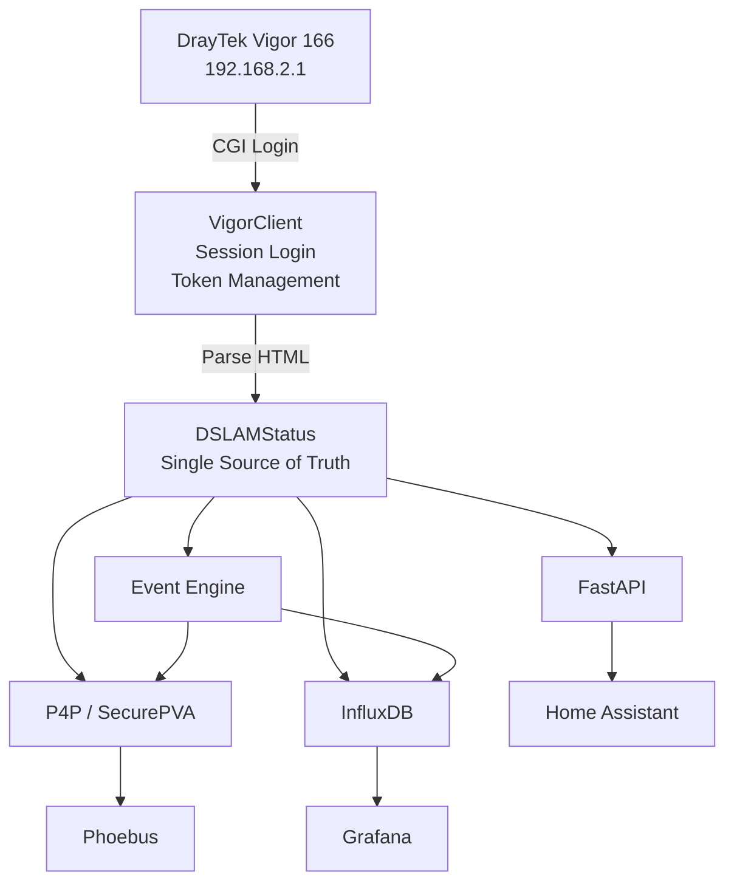
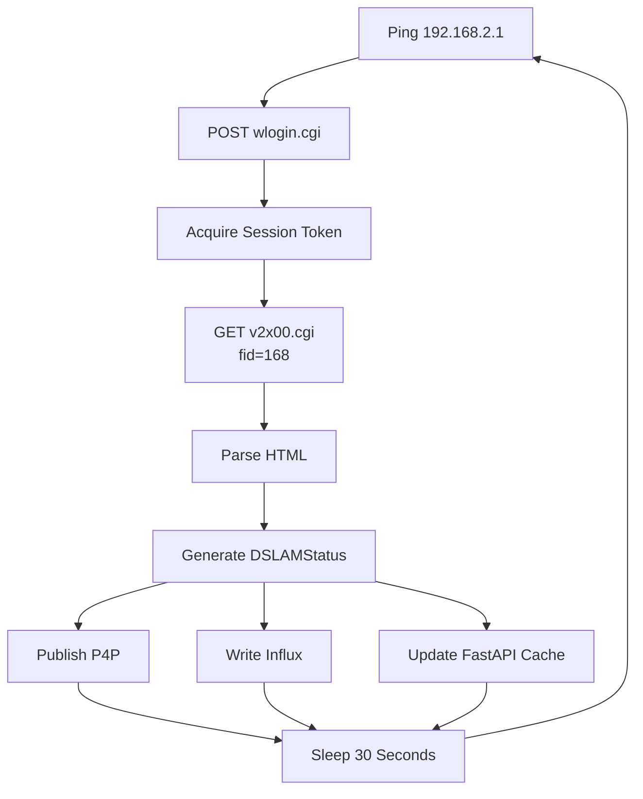
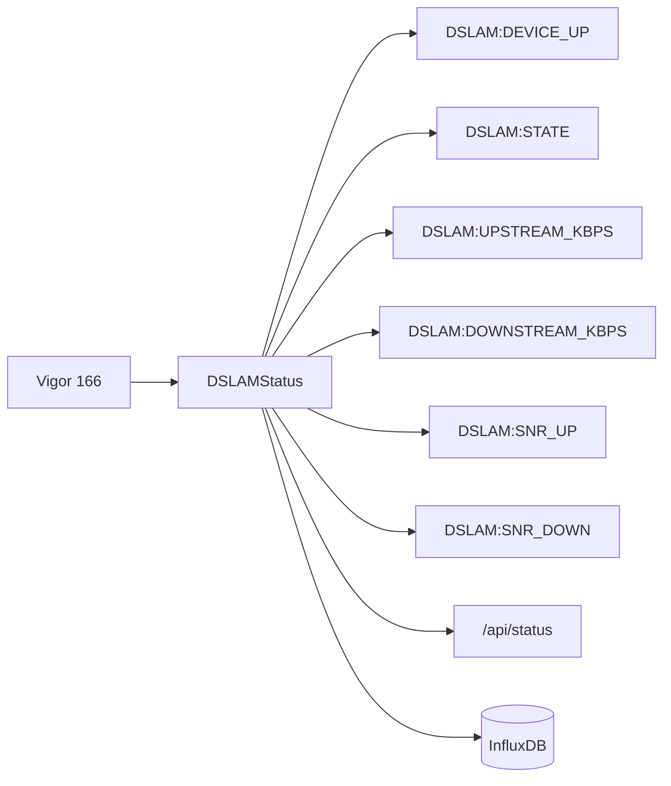

# DraySLAM

> BSD-3-Clause Licensed  
> A lightweight broadband telemetry platform for the **DrayTek Vigor 166**, combining **EPICS P4P**, **InfluxDB**, **FastAPI**, **Grafana** and **Home Assistant** into a single monitoring service.

DraySLAM establishes an authenticated session with a DrayTek Vigor 166 modem, extracts DSL operational statistics directly from the modem's CGI interface, and republishes the resulting telemetry to multiple consumers.

The system is designed around a single source of truth:

```text
DSLAMStatus
```

Every component consumes the same telemetry object:

- P4P / SecurePVA
- InfluxDB
- FastAPI
- Phoebus
- Grafana
- Home Assistant

This avoids duplicated modem polling and provides a clean separation between acquisition, storage and presentation.

---

# Features

✅ Authenticated Vigor 166 CGI login

✅ Session token management

✅ Device reachability monitoring

✅ DSL synchronisation monitoring

✅ SNR monitoring

✅ Profile monitoring

✅ System uptime monitoring

✅ InfluxDB historian

✅ FastAPI REST interface

✅ EPICS P4P publishing

✅ Phoebus support

✅ Grafana support

✅ Home Assistant support

✅ Event detection framework

✅ Ready for SecurePVA integration

---

# Architecture



---

# Polling Cycle



---

# Telemetry Flow



---

# Project Structure

```text
drayslam/

├── .env
├── requirements.txt
├── main.py
│
├── dslam/
│   ├── client.py
│   ├── model.py
│   ├── events.py
│   └── parser.py
│
├── epics/
│   ├── pva_server.py
│   ├── publisher.py
│   └── pv_names.py
│
├── influx/
│   ├── writer.py
│   └── schema.py
│
├── api/
│   └── server.py
│
├── simulator/
│   └── fake_dslam.py
│
├── systemd/
│   └── drayslam.service
│
└── LICENSE
```

---

# Environment Configuration

Create a `.env` file:

```bash
DSLAM_HOST=http://192.168.2.1
DSLAM_USER=admin
DSLAM_PASS=REPLACE_ME

INFLUX_URL=http://localhost:8086
INFLUX_ORG=HomeLab
INFLUX_BUCKET=DSLAM
INFLUX_TOKEN=REPLACE_ME
```

Protect the file:

```bash
chmod 600 .env
```

---

# Requirements

Install dependencies:

```bash
pip install -r requirements.txt
```

Current development dependencies:

```text
requests
beautifulsoup4
lxml

python-dotenv
pythonping

fastapi
uvicorn

influxdb-client

p4p
pvxslibs
```

---

# Installation

Create a virtual environment:

```bash
mkdir -p ~/venvs

python3.15 -m venv ~/venvs/drayslam

source ~/venvs/drayslam/bin/activate

pip install --upgrade pip setuptools wheel

pip install -r requirements.txt
```

---

# Running

Start the collector:

```bash
source ~/venvs/drayslam/bin/activate

python main.py
```

Expected output:

```text
2026-11-12 12:00:00 INFO State=SHOWTIME Down=31010Kbps Up=9696Kbps Device=True
```

---

# Device Monitoring

DraySLAM continuously monitors:

| Parameter | Source |
|------------|------------|
| DEVICE_UP | ICMP Ping |
| State | DSL Status Page |
| Profile | VDSL Profile |
| Upstream Rate | CGI HTML |
| Downstream Rate | CGI HTML |
| SNR Up | CGI HTML |
| SNR Down | CGI HTML |
| Uptime | CGI HTML |

---

# Published P4P PVs

```text
DSLAM:DEVICE_UP

DSLAM:STATE

DSLAM:PROFILE

DSLAM:UPSTREAM_KBPS
DSLAM:DOWNSTREAM_KBPS

DSLAM:SNR_UP
DSLAM:SNR_DOWN

DSLAM:UPTIME

DSLAM:LAST_EVENT
```

Planned PVs:

```text
DSLAM:CRC

DSLAM:FEC

DSLAM:HEC

DSLAM:ATTENUATION_UP
DSLAM:ATTENUATION_DOWN

DSLAM:ATTAINABLE_UP
DSLAM:ATTAINABLE_DOWN

DSLAM:DEVICE_RTT_MS
```

---

# FastAPI Endpoints

## Health Check

```http
GET /healthz
```

Example:

```json
{
  "status": "ok"
}
```

## Current Status

```http
GET /api/status
```

Example:

```json
{
  "device_up": true,
  "state": "SHOWTIME",
  "profile": "17A",
  "upstream_kbps": 9696,
  "downstream_kbps": 31010,
  "snr_up": 9,
  "snr_down": 6
}
```

---

# InfluxDB Schema

## Metrics

Measurement:

```text
dslam_metrics
```

Fields:

```text
device_up

upstream_kbps
downstream_kbps

snr_up
snr_down
```

Tags:

```text
profile

state
```

---

## Events

Measurement:

```text
dslam_events
```

Examples:

```text
DEVICE_UP
DEVICE_DOWN

RETRAIN

WAN_UP
WAN_DOWN
```

---

# Home Assistant Integration

Example REST sensor:

```yaml
rest:
  - resource: http://drayslam.local:8000/api/status

    sensor:

      - name: DSL Downstream Rate
        value_template: "{{ value_json.downstream_kbps }}"

      - name: DSL Upstream Rate
        value_template: "{{ value_json.upstream_kbps }}"

      - name: DSL SNR Down
        value_template: "{{ value_json.snr_down }}"
```

---

# Phoebus Integration

Trend the following PVA channels:

```text
DSLAM:DOWNSTREAM_KBPS

DSLAM:UPSTREAM_KBPS

DSLAM:SNR_DOWN

DSLAM:SNR_UP

DSLAM:DEVICE_UP
```

---

# Example Systemd Service

```ini
[Unit]
Description=DraySLAM
After=network-online.target
Wants=network-online.target

[Service]
Type=simple

User=tims

WorkingDirectory=/home/tims/venvs/drayslam

EnvironmentFile=/home/tims/venvs/drayslam/.env

ExecStart=/home/tims/venvs/drayslam/bin/python \
          /home/tims/venvs/drayslam/main.py

Restart=always
RestartSec=30

StandardOutput=journal
StandardError=journal

[Install]
WantedBy=multi-user.target
```

---

# Development Roadmap

## Alpha

- Vigor 166 Authentication
- CGI HTML Parsing
- InfluxDB Publishing
- FastAPI Interface
- Basic P4P Publishing

## Beta

- Event Engine
- Retrain Detection
- CRC/FEC Extraction
- Grafana Dashboard Pack
- SecurePVA Authentication

## Release 1.0

- Home Assistant Package
- Multi-Line Support
- Docker Deployment
- Full Ansible Deployment
- Alarm Framework

---

# License

BSD 3-Clause License

Copyright (c) 2026 Tim Speight

Redistribution and use in source and binary forms, with or without modification, are permitted provided that the conditions of the BSD 3-Clause License are met.

See the accompanying LICENSE file for the complete license text.

---

# Author

**Tim Speight**  

DraySLAM was created to provide an EPICS-native DSL telemetry platform capable of feeding modern observability stacks while remaining lightweight enough to run continuously on a Raspberry Pi 4.